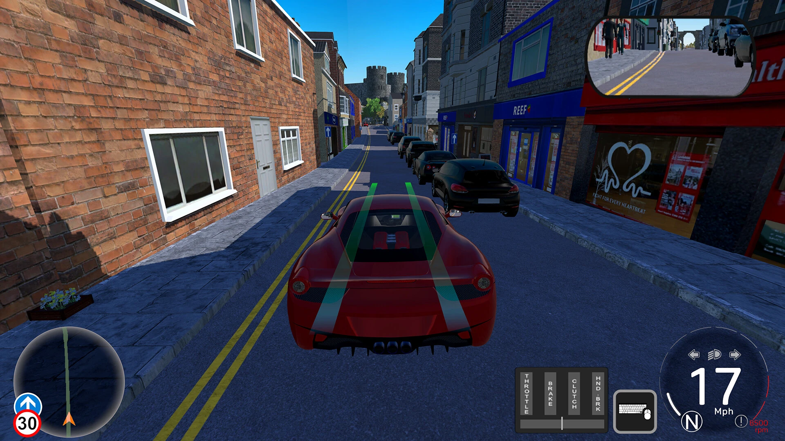
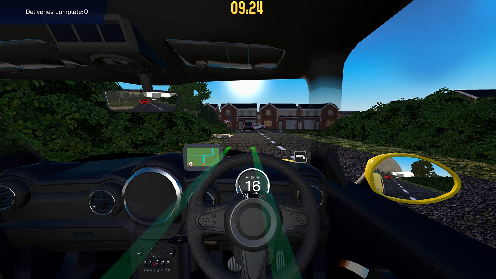
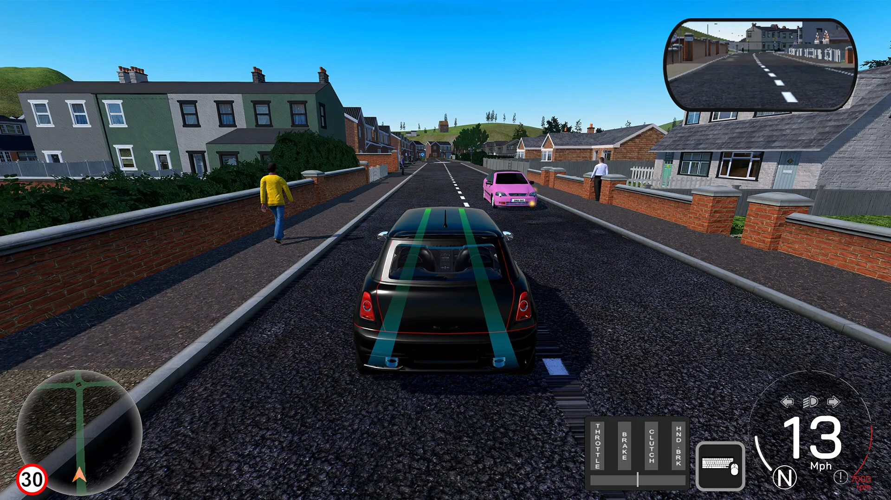

# Interface guidelines

House rules for anything the learner sees while driving. They come from testing the simulator, and they
are the first thing to check before adding a panel, a message or a control.

## The view is the product

The learner is looking at a road. Everything drawn on top of it costs them something.

- **Nothing is drawn across the road. Ever.** There is no banner element any more: it was a slab of
  text over the windscreen. Anything that must reach the learner mid-drive goes to the HUD box as
  `test.alert = { label, tone }`, where `tone` is `info`, `warn` or `stop`, and the label is a few
  words. That is where they already look for what to do next.
- **No large panels during a drive.** A control is a pill or an icon button at the edge of the screen,
  not a card in the corner of the view. The parking control is the model: one small button, bottom
  centre, clear of the touch controls.
- **Never cover the middle of the screen** with text while the car is moving.
- Anything that can be read after the run belongs after the run.

## Never say twice what the lesson card already said

This is the rule most often broken, and the easiest to break by accident. The learner reads the goal
and the steps on the lesson card, chooses to begin, and then drives. Repeating any of it while they
are driving is clutter, and they skip it anyway.

Before adding any text to a drive, ask two questions. If either answer is yes, it does not go on.

1. **Is it on the lesson card?** "Let it through", "Hold the speed", "Reverse into the space",
   "Check before moving" — all of these were already read before Start.
2. **Can the learner see it for themselves?** A police car with its lights on does not need a caption
   saying there is a police car. Nor does a highlighted parking bay need a label.

What is left, and all that is left:

- **Readings the learner cannot otherwise know** — a distance counting down, a speed band, `0/3`
  checks recorded, metres to the target. Numbers and marks, not sentences.
- **Navigation** — which way to go at the next junction. The card never said that.
- **Something has gone wrong and needs recovery** — "Stop first" when Park is tapped on the move.
- **A stimulus with nothing to see** — the examiner's "STOP" in the emergency stop. There is no police
  car to notice and no card entry that says *when*: the moment is the exercise.

A label that merely names the stage is not state, it is the card again. The parking lesson shows the
distance to the target and nothing else: the one button names the action and the highlighted bay shows
where it is.

## Say less

- **Instructions belong on the lesson card, before Start.** The learner reads the goal and the steps
  there, chooses to begin, and then wants to drive.
- **During the drive:** at most a short stage label in the HUD — three or four words, a state and not a
  sentence ("Reverse into the space"). No running commentary, and never the same line in two places.
- **Words on screen mid-drive are for things that have gone wrong** ("Come to a stop first"), and they
  go away again.
- **After the run:** all the detail, in the feedback. See below.

## Instruments, not sentences

A line of text that updates while the learner drives is an instrument we failed to build. The car
already has a distance field, a speedometer and an eye button; use them.

| Don't | Do |
| --- | --- |
| "Brake to stop: 18 metres left" | The distance field, which already reads in yards and metres |
| "Hold 10–15 mph: 1.4 / 3 seconds" | A target band under the speed, and a count in the distance field |
| "Repeat Interior, Right and Blind spot" | Three ticks that fill as each check is recorded |
| "Blue lights behind you…" | Nothing. It is on the card, and the mirrors are the exercise |
| "It is past. Carry on when it is safe." | Nothing. The event is over |
| "Release the parking brake" as a stage label | Nothing. The button already says it, right below |

The one exception is **Coaching** (Settings → Coaching, off by default). A learner who asks to be
talked through a drive gets `test.coach` on a card in the `.hud-bl` column, above the Highway Code
tip. Two rules hold it in place: it goes in that column, never a new absolutely-positioned box, so
the column's own layout keeps it off the instruments at every width; and the default stays silent, so
nothing above changes for anyone who has not asked. `npm run test:drive` checks both — hidden with
the setting off, and clear of the map, speedometer, look buttons, instruction box and touch controls
at 390, 820 and 1280 px when it is on.

Scenarios report state through `test.basicStatus` — `{ label, value, band, checks }` — and `ui.hud()`
draws it. `ui.banner()` still exists for the scenarios that call it, but it now writes `test.alert`
rather than painting anything over the road, and its text must be short enough for the HUD box.

## One control, and controls the learner already has

- A manoeuvre gets **one** control. Parallel parking has a single button that releases the parking brake
  to set off and applies it to park. No cockpit drill, no P/R/N/D selector.
- **Reuse the existing inputs rather than adding new ones.** Reverse is the back arrow held down, the
  same as everywhere else in the simulator.
- A new key must not take a key that already means something. `B` is the interior mirror, `Z` and `X`
  look left and right, `Q` and `E` are the indicators.
- **Prefer a gesture that matches the real movement over another button.** A mirror glance and a
  blind-spot check are the same head movement held for different lengths, so a tap on `X` records the
  right mirror and holding it records the blind spot. That deleted a three-button panel outright.

## Steering a person can manage

The car is driven by people on keyboards, touch buttons and game controllers, not by the reference bot.
Keys and touch buttons are all-or-nothing, so the car has to forgive that without driving itself.

- **Steering is limited by grip, not by the keys.** Full input turns the wheels as far as the tyres
  could use: full lock at walking pace, then no more than about 7 m/s² sideways (`HANDLING.turnGrip`,
  `steerLock` in `js/config.js`). Full input at 30 mph used to turn the car at about 25 m/s², which no
  car can do, so every tap was a swerve. The test drivers steer by wheel angle through the same limit
  (`steerFor`), so they cannot do what a person's car cannot.
- **Controllers are first-class.** The left stick or a wheel steers, the triggers are the pedals, LB and
  RB indicate and Y checks the mirrors. A controller is followed closely; keys wind the wheel on
  gradually. Keys always win over an idle controller.
- **Don't ask for what is already on screen.** In the chase view the mirrors are always shown, and the
  car's surroundings with them, so mirror and shoulder checks count as made the whole time: there is no
  key to press and nothing is marked. The run detail says the drive was in the chase view and that those
  checks were not marked, so a pass there is not mistaken for a mirror routine. In the driver's view they
  are marked as before, and the mirror-practice lesson asks for them in any view.
- **Leaving the road is never free.** A wheel over the edge of the road as drawn is mounting the kerb
  (a driving fault); the middle of the car off the road is driving off it (serious). Free drive marks
  nothing but its summary still says how long the wheels were off.
- **Check it with people's limits, not the bot's.** The Bot lab's driver choice runs any drive as *a
  person on keys* or *a person on a controller*: the reference driver's intentions seen 0.3 s late,
  decided ten times a second, with taps on keys or a slightly unsteady stick, and steering no firmer
  than that reaction time allows without weaving. `BOT_DRIVER=keys npm run test:bots` sweeps everything
  that way. Its pass rate is a guide to difficulty, not a promise: it depends on what the model assumes
  about people.
- **Check it in traffic it has not seen.** Lesson traffic is scripted, so the same drive meets the same
  cars every time and a driver can be tuned to that pattern. The Bot lab's traffic choice (*Random
  traffic*, `BOT_TRAFFIC=random`) runs the drive in ordinary background traffic instead, a different mix
  for each run's seed. Sweep the motorway lessons that way before changing a lane rule.

## Marking: Easy, Medium and Hard

How strictly a drive is judged is the learner's choice, made where the drive starts (the lesson, puzzle
and mock-test panels), and fixed for that drive (`test.marking`, `js/assessment.js`). A pass earns one
star on Easy, two on Medium and three on Hard; the lesson keeps its best.

- **Hard is the real standard.** It is exactly what every drive was judged on before modes existed, and
  for a mock test it is the real test: 15 or fewer driving faults, no serious faults. The Bot lab always
  marks on Hard.
- **Easier modes allow more, never everything.** Medium allows three more driving faults and one fault in
  the lesson's own subject; Easy six more, and forgives one serious fault. Neither forgives a collision,
  and the lesson's goal (overtake the lorry, join the motorway) is required in every mode.
- **Say which mode it was.** The result shows the stars and "marked on Medium"; a mock test passed below
  Hard says the real test is Hard. Changing the mode after a drive changes nothing it earned.

## Camera

- **Looking round never steers the car.** `Z` and `X` swing the camera; the car keeps the heading the
  learner gave it.
- The cockpit is a child of the camera, so anything that yaws the camera must cancel that yaw on the
  cockpit group, or the bonnet swings and the car looks like it is turning.
- **Do not force a camera view on the learner.** Parking does not switch them to the overhead view;
  they choose with `C` or the view buttons.
- **How far the head turns is the point.** A glance in a door mirror is about **45°**; holding the
  same key until it becomes a blind-spot check opens out to about **95°**, over the shoulder; `B` is
  the interior mirror, so it barely moves the head at all (**15°**). The chase view uses 0.8 of those,
  because the car is in shot as well. `LOOK` in `js/main.js` holds all three, and
  `npm run test:drive` measures them.
- **The steering wheel turns with the driver's hands, not the road wheels.** `WHEEL_LOCK` is 2.3 rad
  at full lock — not the real 450°, which spins out of sight when full lock is one key press away.
- **The rear-view mirror belongs in the chase view too.** It is the same camera and the same render
  target as the glass on the windscreen, shown as a panel under the instruction box.

## Mirrors and panels on a phone

Anything drawn into the 3D view has to be placed from the interface's own measurements, not from a
guessed share of the screen. A fraction that looks right on a desktop window goes straight through the
speedometer on a phone held sideways, where the same controls take a far taller share.

- Place it from `getBoundingClientRect()` on the real elements — see `hudChaseBox()` in `js/main.js`,
  which hands `layoutChase` the bottom of the instruction box and the inside edges of the map and the
  speedometer cluster — and never cache the measurement: it goes stale the moment the phone is turned.
- **An upright phone starts in the chase view**, so anything that only exists in the cockpit has to be
  reachable from the chase view as well, or a phone learner never sees it.
- The driver's view is much narrower upright than it is on a desktop, so things off to the side fall
  off the edge. `mirrors.fitView()` draws the rear-view mirror in towards the middle until it fits,
  because that mirror is what the blue-light exercise is about.
- `npm run test:drive` checks the lot at 1280×720, 390×844 and 844×390: on screen, clear of the map,
  the speedometer, the look buttons, the instruction box and the touch controls.

## Feedback after every run

- The result sheet carries a measured account of the run: how long it took, how far, each stage of a
  manoeuvre with the distance travelled, contacts, the final position and angle, observations, and every
  fault by category.
- **Every line must come from something the drive recorded.** `runDetail()` in `js/reports.js` reads
  scenario events and marked faults. It never flatters, never guesses, and never changes the result.
- **A fault must be the learner's to own.** Before marking something, rule out the cases where they had
  no choice: held in a queue, stopped behind a stationary vehicle, waiting at a give-way line, or sat at
  a red light while the thing being judged is still a long way off. Geometry is the usual trap — a test
  of the form "within the corner radius plus a road width" calls a car waiting 20 m short of a junction
  "in the junction". Prefer the junction node and half the widest road meeting it, require the state to
  hold for a second or two rather than a single frame, and check it by running `npm run test:bots` on a
  clean drive: a fault the bot collects on a route it otherwise drives well is almost always ours, not
  its. `BOT_SEED` runs the same sweep on another traffic seed, which separates a real regression from
  one drive diverging.

## On the road

- **The Cambridge map is surveyed, not guessed.** `data/corrections/` holds the correction sets the
  road inspector produced from street-level imagery, and what was taken from each. Anything that adds
  a marking the examiner marks against — a zebra, a stop line — is de-duplicated against what the map
  already carries, because two crossings in one place means two faults for one mistake.
- **UK conventions.** Parking bays are broken white lines. Give-way and stop lines, signals and signs
  follow the Highway Code, and each lesson cites the rule it teaches.
- **Every vehicle comes from the shared catalogue** in `js/cars.js`: the learner's car, the background
  traffic, the parked cars and the blue-light vehicle are all cars the learner could choose in the
  garage. Nothing on the road should be a coloured box once the models have loaded.
- **L plates belong to the learner alone.** `loadCarModel` takes `learner: false` for everyone else.
- **The driver's seat belongs to the car that was chosen.** The cockpit is a hand-built impression
  rather than a model of an interior, so its proportions stay as they are, but its paint and width come
  from the selected car via `carMetrics()`. A textured model carries its colour in the image, not the
  material, so the colour is sampled from the texture; and the body is the part with the most
  triangles, not the biggest box, or a black roof panel wins over the body around it.

## Motorways

The motorway worlds (`m2`, `m3`) are a closed 24 km circuit drawn by `motorway()` in
`tools/layouts.mjs` from the constants in `js/motorway.js`, so a drive can go on as long as the learner
likes without the road network ever growing. Scenery chunks further than `WORLD.freeRadius` from the car
are freed, and `npm run test:free` checks over a 14-minute drive that memory levels off.

- **Markings follow the Traffic Signs Manual, chapter 5.** Lane lines over 40 mph are diagram 1005.1:
  2 m marks with 7 m gaps, 150 mm wide. The edge line beside the hard shoulder and the broken line along
  a deceleration or acceleration lane are close approximations of 1012.1 and 1010 — we could not reach
  the published drawings when this was built, so treat their widths as ours, not the manual's.
- **Free drive is ungraded.** It never marks a fault, never decides a result and never writes to the
  learner's record or account. Leaving at a junction is not "off route": a way back onto the circuit is
  built from wherever the car is. Ending the drive shows a summary of what was measured, and says plainly
  that nothing was added.
- **Lane discipline is judged in context** (`js/lane-discipline.js`, issue #7). Being out of the
  left-hand lane is not a fault in itself: overtaking something slower in the lane to your left, or
  waiting for a vehicle less than two seconds behind on that side to drop back, justifies it. What is
  marked is what the learner chose: a lane change with no mirror check or no signal; pulling into a gap
  that makes someone brake (under 1.5 s and closing, or under 1 s; serious under 0.5 s); cutting in
  (under 1 s); sweeping across two lanes without settling for 3 s; more than 10 s out with nothing to
  pass (Rule 264); under two seconds behind for more than 5 s (Rule 126; serious under 0.8 s for 2 s);
  passing on the left more than 5 mph faster (Rule 268, which allows keeping up with your own lane);
  and not being in the left-hand lane 300 yards before an exit (Rule 272). The assessor is pure and fed
  one frame at a time, so `tests/lane-discipline.test.mjs` judges scripted traces with exactly the
  rules a live drive gets, and the Bot lab's motorway driver uses its `overtaking()` test so the
  reference driver and the examiner can never disagree about when staying out is justified.
- **Joining traffic gives way; motorway traffic never has to** (issue #8, Rule 259). Joining is a lane
  change from the acceleration lane ("lane −1", measured from the carriageway) into lane 1, with the same
  checks, plus being far slower than the traffic (over 20 mph slower) and moving out again within 5 s.
  On the main carriageway, keeping your lane and speed, easing off, and moving over into a safe gap are
  all accepted; being in the middle lane while traffic comes down a slip road beside you is courtesy,
  not hogging. What is never accepted is "making room" by moving into a gap that makes someone brake.
- **Background traffic keeps left (Rule 264).** On any road with two or more lanes each way, slower
  vehicles start in the left-hand lane; a vehicle in an outer lane with nothing slower to pass moves back
  left into a gap, pulls out to pass something slower, and gets into the left-hand lane in good time for
  a motorway exit. It changes lane at half a lane a second, and never moves in front of the learner with
  less than 2.5 s between them. A lesson's own placed traffic stays where the lesson put it.
- **Background traffic says what it is about to do.** A vehicle that is going to change lane flashes its
  indicator for a couple of seconds first, then moves; one in twenty drivers never signals, as on real
  roads. With no gap it keeps signalling, eases off to drop in behind anyone keeping pace in that lane,
  and gives up after a few seconds; if someone turns up alongside before it is across, it goes back. The indicators are
  amber lamps on the car itself, so nothing is added to the screen.
- **Drivers differ.** Each background vehicle draws its own following distance, the gap it will accept,
  how long it waits before moving, and whether it is courteous, from the seeded traffic generator, so the
  same seed gives the same traffic but no two cars behave quite alike.
- **Some drivers make room.** About half are courteous: when the learner, alongside or just ahead in the
  next lane, signals into theirs, they ease off and leave a gap; some also move over for a learner on an
  entry slip road when the next lane is free. The rest hold their speed, so a signal is a request, never a
  right, and the gap rule still decides whether the move was safe.
- **A lane change is judged once it is a lane change.** The mirror, signal and sweep checks are applied
  when the car's centre crosses the line, from what was done before it started to move: a drift towards
  the line that comes back is not a lane change. A gap is too small when the vehicle behind would have to
  brake (closing within 3 s, under half a second behind, or under a second and not falling back), not
  for the gap alone: moving in a second ahead of a slower vehicle you are pulling away from makes nobody do
  anything. Moving left and straight off at an exit is cutting across only inside the last 100 yards.
  Someone moving into the gap ahead starts the same grace as a lane change of the learner's own: the
  learner is judged on dropping back, not on having been cut in on.
- **AI joiners obey the same priority.** A vehicle on an entry slip fits into lane 1 only where the
  vehicle behind keeps 1.5 s and is not closing within 4 s; otherwise it drops back behind, and with no
  gap it waits at the end of the acceleration lane, before the taper, because the taper is in the lane
  itself. Nothing on the motorway brakes or moves over for it, and none of it is scripted to collide.
- **Exits are signed the UK way** (issue #9): advance direction signs at 1 mile and ½ mile, countdown
  markers at 300, 200 and 100 yards, and the final sign where the slip road leaves, all placed from
  `MW.advance` and `MW.countdown` and checked in both lane variants. The assessor reads the same 300-yard
  figure. Leaving is a lane change from lane 1 onto the slip road, with a left mirror and signal, and the
  speed kept until on the slip road (slowing by over 20 mph before it is marked). The slip road's bend is
  judged against its own geometry (over 3.5 m/s² sideways is too fast), and crossing the hatching to
  reach it, cutting across from another lane at the last moment, stopping on the carriageway and
  reversing are serious. Not being in the left-hand lane by 300 yards is only marked if there was a
  usable gap within reach after the 1-mile sign; boxed in, carrying on is the right answer, and a missed
  exit always routes on to the next junction, never to an impossible "turn round".
- **One set of junction numbers.** The slip roads' shape (`tools/layouts.mjs`), their markings
  (`js/world.js`), the AI's merge zone (`js/traffic.js`) and the lessons all read `MW.junction.accel`,
  `MW.junction.decel` and `MW.taper`, and `tests/motorway.test.mjs` measures every slip road against them.
- **Motorway lessons script their own traffic.** Background traffic is off (`scenarioVariants`) and
  every vehicle that matters is placed by the lesson, so a run is the same every time; each lesson starts
  far enough along its route for the vehicles placed behind it, which `tests/motorway.test.mjs` checks.
- **Instruments for the motorway:** the lane strip by the instruction box shows the lanes that are right
  for you now (amber) and the one you are in (marked underneath); the following lesson shows your gap to
  the car ahead in seconds, because nothing else on screen can tell you that.
- **At dusk, lighting is all that changes** (issue #10). A lesson or free drive sets `timeOfDay: 'dusk'`
  in its own data; the road, the traffic's priorities and every assessment rule are the same as by day,
  and `npm run test:motorway` drives the same careless lesson in both and requires the same faults. What
  the learner sees changes: a dusk sky and fog that never closes in nearer than 600 m, lamps on every
  vehicle, road studs (white between lanes, red on the left edge, amber by the central reservation,
  green across slip roads), lit columns at the junctions, and signs that glow as they would in
  headlights. Nothing the examiner marks may be hidden by the lighting: if a hazard cannot be seen, it
  cannot be judged. The one thing assessed is the headlights themselves: driving off without dipped
  headlights is a single driving fault under ancillary controls (Rules 113 and 115). The lights button
  shows only at dusk, beside the look buttons, with **H** on a keyboard.
- **Measure what lighting costs.** `npm run evidence -- evening extra` times day, dusk and low power at the same spot, finishing every frame before the next. Anything drawn across the whole circuit (the studs were) belongs in squares drawn only near the car.
- **Low-power graphics** (Settings → Graphics) drop shadows, the headlight beam, the light pools and the
  pixel ratio; the lamps stay, so it is still plain whether the headlights are on. Menus honour
  `prefers-reduced-motion`, which `npm run test:access` checks.
- **Navigation names the next junction, not the end of the circuit.** The instruction box counts down
  to `J2 · Ashwell`; the turn beacon stays hidden, because you pass most junctions straight by.

## What we are aiming at

`docs/development/reference/` holds screenshots of a commercial UK driving simulator, kept as the bar
to clear. They are reference material, not a style to copy: the house rules above win wherever the two
disagree, and the quiet drive is deliberately quieter than theirs.

| | |
| --- | --- |
|  |  |
|  | |

What they get right, and what we took from it:

- **A rear-view mirror in the chase view**, not only in the cockpit. Ours is the panel under the
  instruction box.
- **A cockpit that reads as a car**: a real steering wheel with a rim, a hub and three spokes that
  turns as you steer, a dashboard that closes off the bottom of the view, a windscreen header and
  A-pillars, and door tops for the wing mirrors to sit on.
- **Instruments, not prose** — the same conclusion as our own rules: speed, limit, a route map and
  mirrors, with nothing written across the road.

Where we deliberately differ: their screen carries a pedal and gear strip, a keyboard hint and a
delivery timer. We do not. The view is the product, and everything the learner needs to be told is on
the lesson card before Start or in the feedback afterwards.

## Before you call it done

```sh
npm test                 # unit checks
npm run build
npm run test:parking     # the manoeuvre, driven end to end
npm run test:drive       # look cameras and the blue-light vehicle
npm run test:devices     # five viewports, touch targets, no overlap
npm run test:mobile      # three device profiles, against dist/
npm run test:cars
npm run test:access      # needs a server on 127.0.0.1:8000
npm run test:browser     # the course end to end: prerequisites, control lessons, saved progress
npm run test:bots        # BOT_PICK=all:lesson | all:mock | all:puzzle
npm run test:free        # motorway free drive: both layouts and dusk, a 14-minute dusk drive with memory sampled
npm run test:motorway    # motorway lessons: careless driving marked, repeatably; lane strip, gap reading, dusk
npm run test:control     # leaving the road marked, steering limits, game controllers
node tools/screenshots.mjs   # regenerate docs/screenshots and docs/screenshots.md
npm run evidence -- <group>  # real-time videos of a feature, into docs/evidence/
```

Touch targets are at least 44 px on a coarse pointer, nothing overlaps, and nothing runs off the screen
at 320 px wide. `npm run test:devices` checks all three. `npm run test:drive` checks that the banner
element does not exist at all, that no panel sits over the road during the Getting started lessons or
while a blue-light vehicle is being dealt with at phone size, that the alert is short enough for the
HUD, and that the HUD pieces do not overlap each other.

**Every feature pull request carries video evidence.** Add a group to `GROUPS` in
`tools/record_evidence.mjs` with one short clip per thing the issue asks for, run
`npm run evidence -- <group>`, commit the clips and the `README.md` it writes under `docs/evidence/`, and
link that folder from the pull request. Keep each clip under a minute: they are evidence, not a film.

When the course or the interface changes, regenerate the screenshots and commit them: `docs/screenshots.md`
is the quickest way to see what a change did to every case at once.
