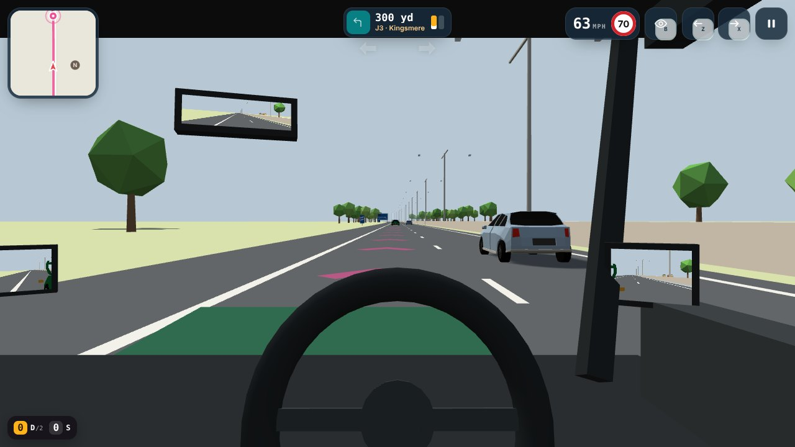
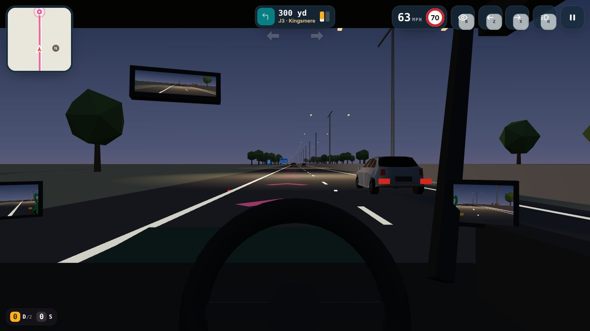
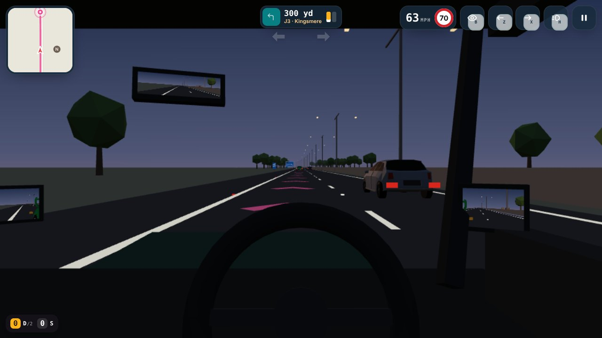

# Evening motorway driving (issue #10)

Recorded with `node tools/record_evidence.mjs evening` on 2026-10-24: the real application,
stepped at 20 frames a second and captured frame by frame, so each clip plays at true speed unless it says otherwise.
The careful drives use the Bot lab's reference driver (`js/bots.js`), which switches dipped headlights on before moving off; the careless one uses the scriptable driver from `npm run test:motorway` (`tests/mw-driver.mjs`) and leaves them off.

## Joining at dusk

Joining at dusk from the driver's seat: dipped headlights on, the slip road's green studs, the lit junction, and the traffic in the left-hand lane read by its headlights in the mirror.

[01-joining-at-dusk.mp4](01-joining-at-dusk.mp4) · 36 s · 1.0 MB

## Following by brake lights

Following as the traffic slows at dusk: the brake lights ahead give the warning, and the gap stays over two seconds. Chase view, then the driver's view.

[02-following-by-brake-lights.mp4](02-following-by-brake-lights.mp4) · 30 s · 0.7 MB

## Signs and studs at the exit

Leaving at junction 3 at dusk: the ½-mile sign and the countdown markers lit, the green studs where the slip road leaves, red studs along the left edge, and the lighting columns at the junction.

[03-signs-and-studs-at-the-exit.mp4](03-signs-and-studs-at-the-exit.mp4) · 36 s · 0.8 MB

## No headlights and what it is marked for

The same following lesson driven with the headlights left off: the tail lights and studs still show, but the car is not lit ahead. The result marks it, once, as a driving fault under ancillary controls (Rules 113 and 115).

[04-no-headlights-and-what-it-is-marked-for.mp4](04-no-headlights-and-what-it-is-marked-for.mp4) · 26 s · 0.6 MB

## Free drive at dusk

Free drive on the three-lane circuit at dusk, from the chase view: every vehicle's lamps, the lit junction, and the studs marking the lanes.

[05-free-drive-at-dusk.mp4](05-free-drive-at-dusk.mp4) · 18 s · 0.8 MB

## The same spot by day and at dusk

From the driver's seat, 330 m before junction 3 with the headlights on: by day, at dusk, and at dusk on low-power graphics (no shadows, no headlight beam or light pools, the lamps still on).

## What it costs to draw

Milliseconds per frame (simulation and drawing, median of three runs of 30 frames) at the same spot. Measured in the headless software renderer these clips are made with, so the numbers compare day, dusk and low power with each other; they are not what a phone or laptop GPU will do, which still needs measuring on real devices.

| Window | Lighting | ms per frame |
|---|---|---|
| 1280×720 | day | 123.2 |
| 1280×720 | dusk | 319.8 |
| 1280×720 | dusk, low power | 251.7 |
| 390×844 | day | 84.2 |
| 390×844 | dusk | 263.8 |
| 390×844 | dusk, low power | 220.8 |
