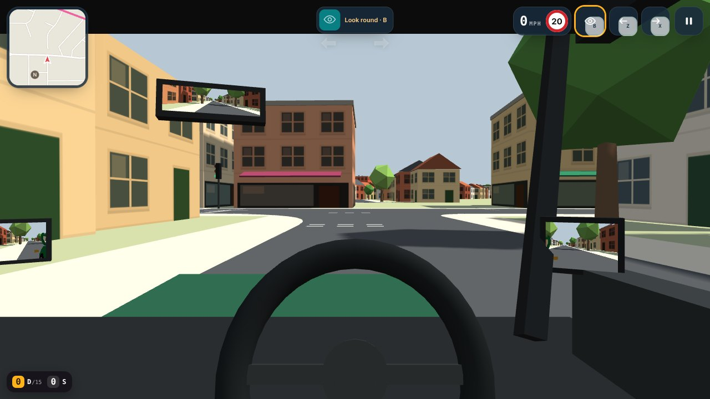
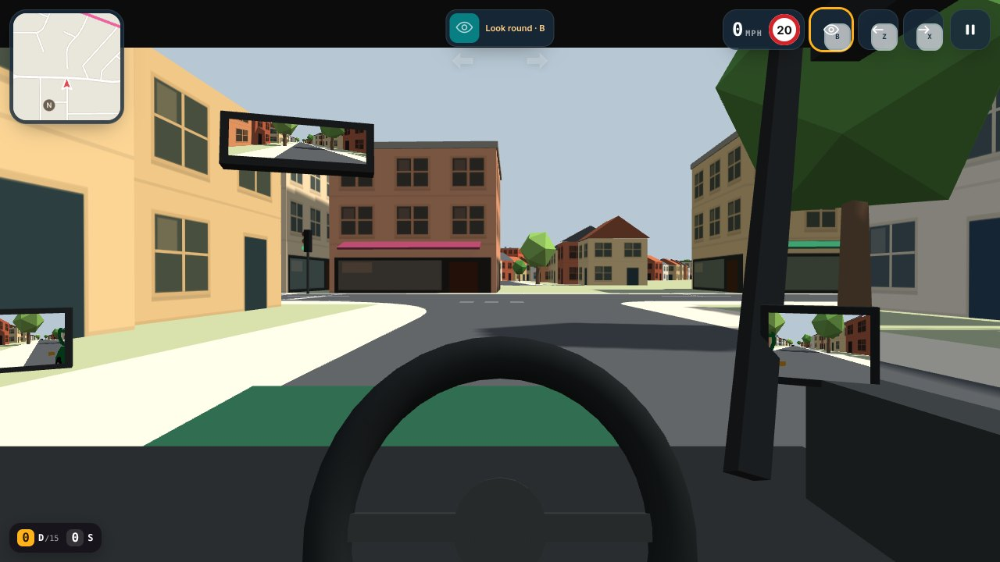
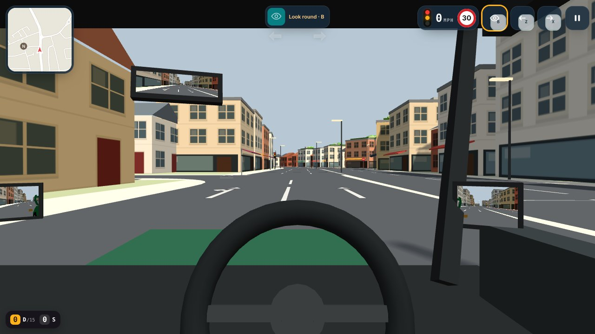
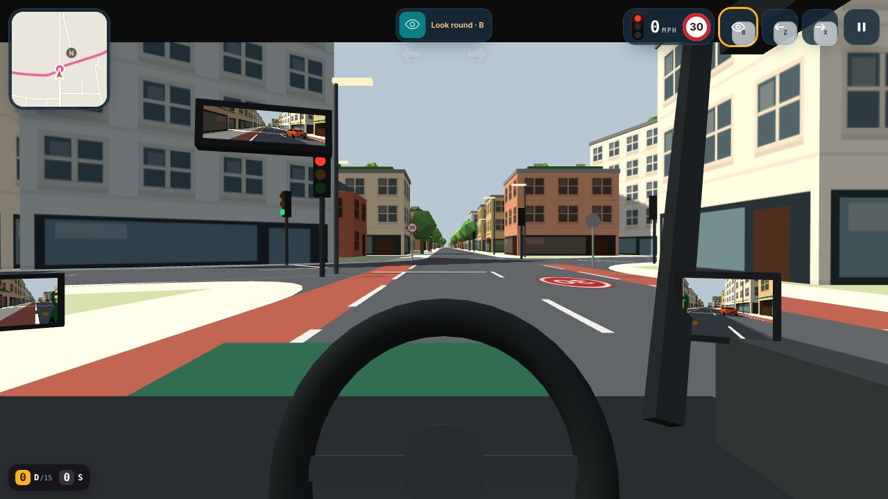
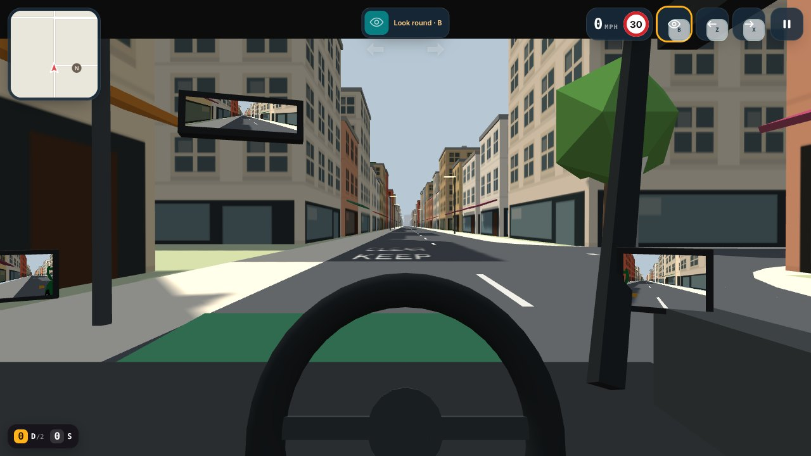

# Junction markings and KEEP CLEAR (issue #4)

Recorded with `node tools/record_evidence.mjs markings` on 2026-10-25: the real application,
stepped at 20 frames a second and captured frame by frame, so each clip plays at true speed unless it says otherwise.
The car is driven by the steady driver the browser checks use, along the lane and up to the line at each junction.

## Side road give way

Ascham Road to Milton Road from the driver's seat: one give-way line at the mouth of the junction (the map had two on this approach, one inside the junction), and Milton Road's centre line broken across the side road.

[01-side-road-give-way.mp4](01-side-road-give-way.mp4) · 20 s · 0.6 MB

## Newmarket road

Newmarket Road towards Godesdone Road: the lane line now stops short of the junction instead of running into it from a 4 m stub of road.

[02-newmarket-road.mp4](02-newmarket-road.mp4) · 20 s · 0.7 MB

## Crossroads

Hills Road into the Lensfield Road crossroads: the lane lines lengthen on the approach and end at the stop line.

[03-crossroads.mp4](03-crossroads.mp4) · 22 s · 0.7 MB

## Keep clear

High Street westbound in the practice town: KEEP CLEAR in your lane across the mouth of Orchard Way, so a queue leaves room for traffic turning in and out. Configured for this spot, not painted at every junction.

[04-keep-clear.mp4](04-keep-clear.mp4) · 12 s · 0.6 MB

## Before and after, from the driver's seat

The same spot with the old marking rules (before) and the new ones (after), from the driver's seat about 25 m before the line.

### A side road off Milton Road (Ascham Road), approaching the give-way

| Before | After |
|---|---|
|  |  |

### Newmarket Road at Godesdone Road, where a 4 m stub of road meets the junction

| Before | After |
|---|---|
|  |  |

### Hills Road at the Lensfield Road crossroads, lights and two lanes

| Before | After |
|---|---|
|  |  |

### High Street westbound at Orchard Way in the practice town: KEEP CLEAR

