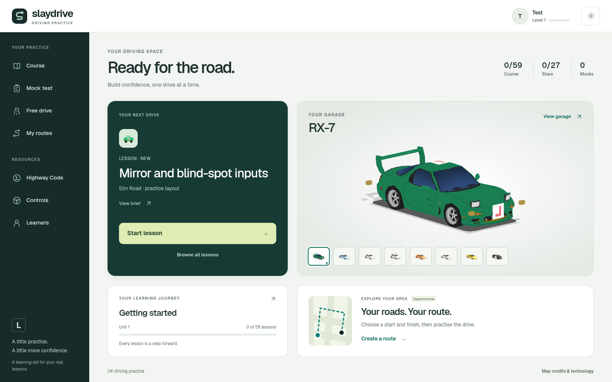
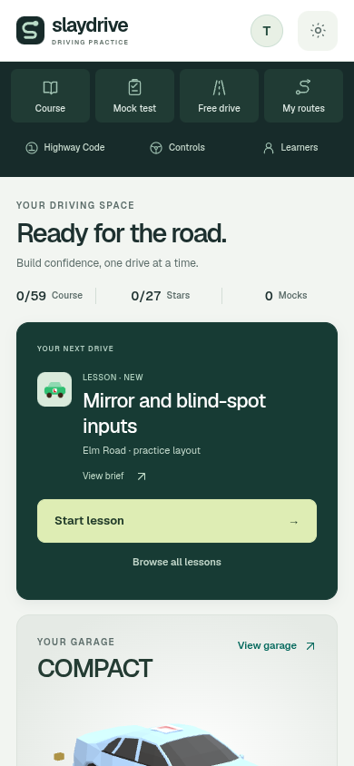
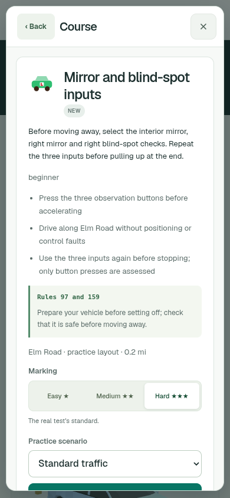
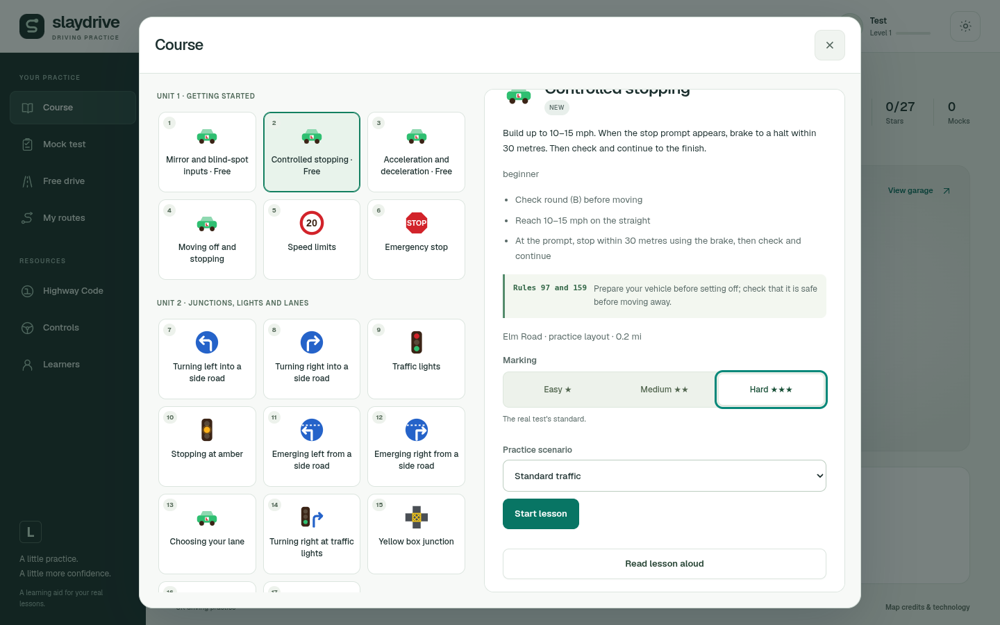
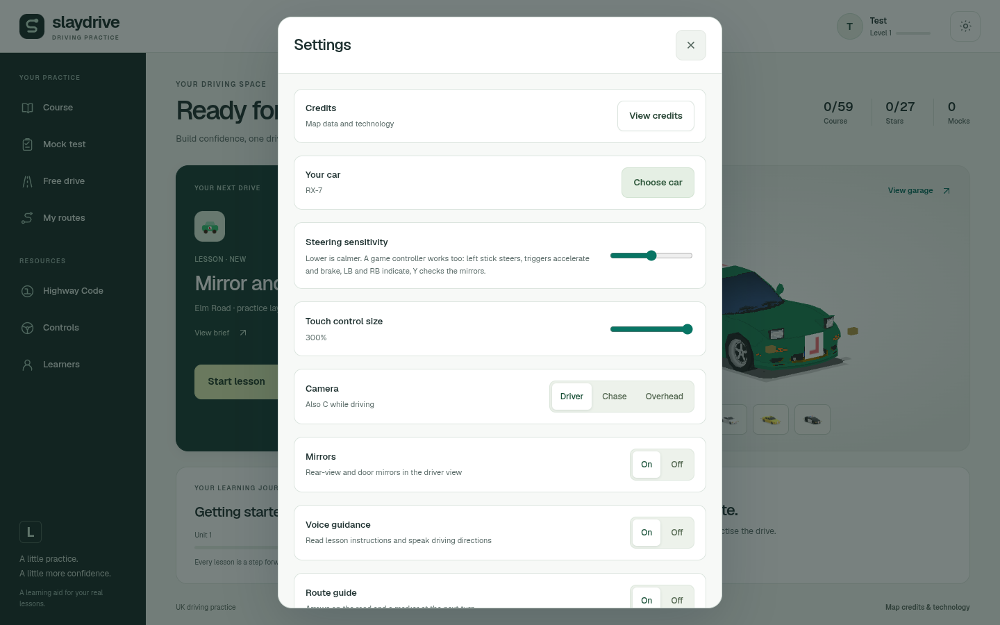

# SlayDrive interface redesign

Built from `main` after PR #23 was merged (`e444919`). Development branch:
`feature/professional-ui`. The branch preview is
[design-review.learner-drive-app.pages.dev](https://design-review.learner-drive-app.pages.dev/).
A new PR gets its own `pr-<number>.learner-drive-app.pages.dev` preview through the existing workflow.
Production deployment remains restricted to `main`; this work does not merge or change DNS.

## Review the design



The new dashboard puts Course, Mock test, Free drive and My routes in one navigation area. A selected
drive has a clear brief and a named Start action. The existing 3D cars appear in a contained garage,
beside measured course progress and a shortcut into the existing personal route builder.

The same typography, teal actions, neutral surfaces, selection states and spacing are applied to
course lessons, quizzes, mock tests, free drive, settings, profiles, the garage, controls, credits,
pause, results and personal routes. The driving HUD uses matching colours and type, retaining its
existing placement and mirror clearances.

| Phone dashboard | Lesson detail |
| --- | --- |
|  |  |

| Course | Settings |
| --- | --- |
|  |  |

Videos: [desktop navigation and garage](desktop.mp4), [phone layout and panels](mobile.mp4).
These are real browser interactions recorded with an offline account fixture. The route-panel
screenshot deliberately blocks map tiles to show the recoverable error state; it is not evidence of
a live map provider. Route generation and driving are exercised separately by the existing route suite.

## What was fixed

- Replaced floating home controls with a grid and scrollable content. Navigation and Start remain
  reachable at 320×568, 390×844, 844×390, 768×1024 and 1440×900.
- Unified panels and controls, including long lesson titles, settings selectors and phone list/detail
  navigation. All 48 existing panel/layout combinations pass without horizontal overflow.
- The selected Free drive card now opens the Free drive brief instead of failing to open a panel.
- Panels trap Tab, restore their opening control on close, and support Escape from form fields.
  Radio groups support arrow keys, Home and End. Selection keeps focus after rendering.
- Corrected conflicting radio ARIA states, labelled earned stars with a supported role, made the
  Highway Code list scrollable by keyboard, and corrected low-contrast labels.
- Kept the font local (Geist Latin variable, ~31 KB, OFL licence). CSS files receive the build version
  so preview updates cannot reuse an old interface stylesheet. No new CDN or UI framework is needed.
- Fitted the existing car models to the garage; its render loop pauses offscreen, under a panel,
  in a hidden tab and for reduced motion.

## Verification

Local Chromium checks use real DOM, input, layout and Three.js rendering with account/provider fixtures.
They do not establish physical-device performance or live payment/provider availability.

| Check | Result |
| --- | --- |
| Frontend unit tests | 248 passed |
| Backend unit tests / TypeScript | 23 passed / passed |
| Production build | Passed |
| Source and built interface interactions | Passed; [record](checks.json) |
| Modal layout matrix | 12 panels × 4 sizes, plus fallback font; passed |
| Keyboard and focus | Tab loop, radio arrows, field Escape, nested panel return; passed |
| Accessibility scan | axe-core 4.14, WCAG 2 A/AA and 2.1 AA rules; zero detected violations across seven inspected screens; [record](accessibility.json) |
| Course, parking, cameras/blue lights, controls | Passed |
| Five driving viewports, car selection/recovery | Passed |
| Android emulation against production build | Pixel 7 portrait/landscape and Galaxy S9+ passed touch driving, rotation and progress restore |
| Access and billing fixtures | Desktop and Android passed; no live charges |
| Personal routes against production build | Passed: search, pins, save/restore, provider failure/retry, continuous drive, mock grading and voice mute |
| Cockpit and mirrors | Passed |
| Box junction and motorway lesson regressions | Passed |
| Bot regression | Controlled-stopping lesson completed through the existing driver |
| Screenshot catalogue | 75 cases regenerated in [the screenshot index](../../screenshots.md) |

The prior road-lesson bot sweep has a known `pz-fourlamps` stall, reproduced on the previous main
snapshot and documented in [personal route evidence](../personal-routes/README.md). That complete
sweep was not repeated for this presentation change. Physical iOS, audible speech output and live
Stripe checkout were not tested here.

The full motorway endurance suite is not included in the passing checks above. Its previously
recorded courtesy-driver speed assertion remains an outstanding baseline finding; the focused
motorway lessons, free-drive entry and camera/controls checks passed.

## Reproduce and preview

```sh
npm ci
npm test
npm run build
npm run test:interface
TEST_SITE=dist npm run test:interface
node tests/modal-layout-browser.mjs
npm run evidence -- interface
node tools/screenshots.mjs
```

Browser checks use Playwright Chromium. Set `CHROMIUM_PATH` if Chromium is installed outside
Playwright's cache; video recording also needs Playwright's FFmpeg and system `ffmpeg` for the MP4s.

For a standalone local visual preview with a guest learner:

```sh
node tools/build_demo.mjs . /tmp/slaydrive-ui-preview --preview
python3 -m http.server 8000 --bind 127.0.0.1 --directory /tmp/slaydrive-ui-preview
```

This explicitly labelled preview opens the course for review and keeps guest progress in the browser.
The ordinary production build retains the existing authentication and entitlement configuration.
The optional billing preview still requires isolated test credentials and an isolated database.

The font is distributed by `@fontsource-variable/geist` 5.3.0. Its licence is committed at
[`assets/fonts/Geist-OFL.txt`](../../../assets/fonts/Geist-OFL.txt).

## Learner progression review

The selected lesson still shows its measured goal and brief before Start. Driving progress stays in
the existing instruments. Results retain measured faults, earned stars and the next lesson; the
dashboard reads those records directly. Free drive stays ungraded, and a new visual style grants
no completion, score, XP or entitlement.
